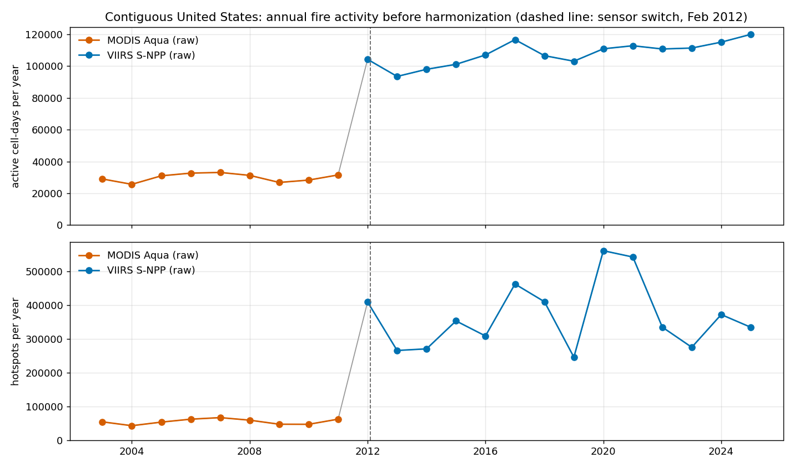
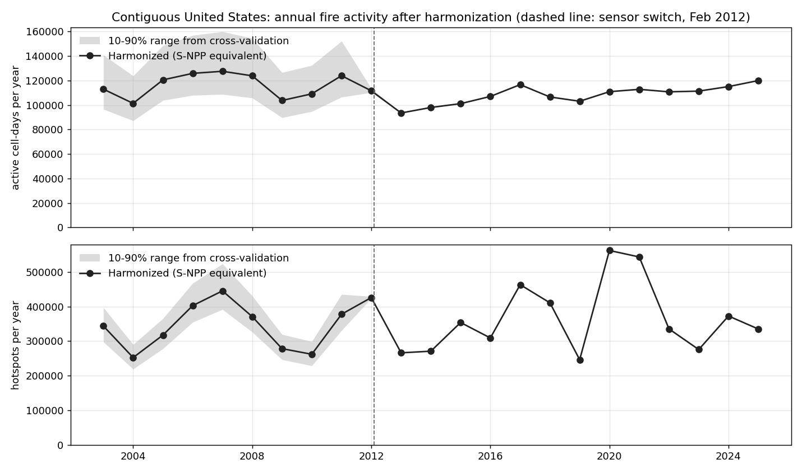

# Burn Calendar

## The problem

Satellites have recorded active fires for more than twenty years, but not with
one instrument. MODIS has pixels of about 1 km, VIIRS 375 m, so VIIRS reports
several times more hotspots for the same fire activity. In the contiguous
United States the raw record jumps by a factor of 6.6 in 2012, the year the
instrument changes. S-NPP stopped producing fire data on 2026-11-02 and MODIS is
near the end of its mission, so without harmonization the long history is cut
off from every future observation.

| Raw record | Harmonized record |
|---|---|
|  |  |

## What this repository does

1. **Harmonizes** NASA FIRMS hotspots from MODIS Aqua, VIIRS S-NPP and VIIRS
   NOAA-20 onto one scale (VIIRS S-NPP), using the years in which the
   instruments overlap. Every value means "what S-NPP would have reported".
2. **Validates** the conversion with leave-one-year-out cross-validation and
   attaches an uncertainty range to every converted value.
3. **Exports** small static data files that a browser can query directly, with
   no backend.
4. **Web application**: pick an area and a date
   range, see the burn calendar, compare the current month with the historical
   median for the same days, and download CSV. See [web/README.md](web/README.md).

## Status

| Part | State |
|---|---|
| Data pipeline (`pipeline/`) | Done. Four regions, data through 2026-11-13. |
| Harmonization and validation | Done. Results in [docs/METHODS.md](docs/METHODS.md). |
| Website data files (`web/public/data/`) | JSON files committed; Parquet files are rebuilt locally (too large for git). |
| Web application (`web/`) | Built: calendar page and methods page. Live at <https://nasa.vicvic88.net>. See [web/README.md](web/README.md). |

## Regions covered

| Code | Region | Coefficient subregions | Active cell-days | Hotspots |
|---|---|---|---|---|
| `usa` | Contiguous United States | `usa_w`, `usa_e` (split at 100° W) | 1,888,331 | 6,023,532 |
| `sea` | Myanmar, Thailand and Laos | `sea` | 3,399,578 | 9,496,343 |
| `arg` | Argentina | `arg` | 1,075,233 | 3,104,974 |
| `twn` | Taiwan | `twn` | 8,336 | 10,820 |

## Method in one screen

| Step | What happens |
|---|---|
| Filter | MODIS: Aqua only (same early-afternoon overpass as VIIRS), confidence ≥ 30, type 0. VIIRS: confidence nominal or high, type 0. Near-real-time rows have no type, so fixed heat sources are removed with a mask built from standard data. |
| Grid | Each hotspot goes to a 0.1° cell and a UTC day: `g = floor(round(deg * 100000) / 10000)`. A cell with at least one hotspot on a day is one **active cell-day**. |
| Learn | For each subregion × calendar month and each metric, `k = sum(S-NPP) / sum(source)` over the overlap: Aqua → S-NPP on 2012-02..2021-12, NOAA-20 → S-NPP on 2018-04..2025-12. Sensor outage days are excluded. |
| Combine | 2003-01..2012-01 = Aqua × k; 2012-02..2026-10 = S-NPP as observed; 2026-11 onward = NOAA-20 × k. Sensors never mix within a month. |
| Validate | Leave-one-year-out. Bias and monthly error meet the targets (≤ 10% and ≤ 30%) in every subregion with enough fires; year ranking before 2012 is weak in three places. |

Full explanation, numbers and limitations: [docs/METHODS.md](docs/METHODS.md).

## Quick start

Requirements: Python 3.11+, [uv](https://docs.astral.sh/uv/) (or plain `pip`),
about 3 GB of free disk for the raw downloads.

```bash
uv venv .venv && uv pip install -p .venv -r pipeline/requirements.txt
```

```bash
pipeline/build_all.sh twn        # one small region (Taiwan, 3 MB download) to test the setup
```

```bash
pipeline/build_all.sh            # all four regions, about 3 GB of downloads
```

Data for the current year (2026) comes from the FIRMS area API and needs a free
[FIRMS MAP_KEY](https://firms.modaps.eosdis.nasa.gov/api/map_key/):

```bash
cp .env.example .env             # then put your key after FIRMS_MAP_KEY=
```

Without a key the build still runs and the data ends in 2025. The key is used
only at build time and is never committed or sent to the website. Details of
every step: [pipeline/README.md](pipeline/README.md).

## Repository layout

```
.
├── pipeline/               Python data pipeline (download → clean → grid → harmonize → export)
│   └── README.md           how to run it, every step and output file
├── web/                    website (Vite, TypeScript)
│   ├── README.md           how to run it, modes, source layout
│   ├── src/                front-end source
│   └── public/data/        data files the website reads (pipeline output)
├── docs/
│   ├── README.md           index of all documents
│   ├── METHODS.md          methods, validation and limitations (also the website's methods page)
│   ├── DATA_FORMAT.md      data contract between the pipeline and the website
│   └── figures/            validation figures, one set of four per region
├── .env.example            template for the FIRMS MAP_KEY
└── LICENSE
```

`data/` (raw downloads and intermediate files) and `web/public/data/*.parquet`
are created by the build and are not in git.

## Data source and citation

NASA Fire Information for Resource Management System (FIRMS),
<https://firms.modaps.eosdis.nasa.gov/>:

- MODIS Collection 6.1 active fire product (Aqua), 2002 onward
- VIIRS S-NPP 375 m active fire product, 2012 to 2026-11-02
- VIIRS NOAA-20 375 m active fire product, 2018 onward

Standard-processing country files for 2002-2025; 2026 from the FIRMS area API
(near-real-time after the last standard-processing month). Country boundaries
for clipping API results: Natural Earth 1:10m Admin 0 Countries, public domain.

NASA does not endorse this project. No NASA logo, flag or mission patch is used.

## Use of SI

The data pipeline code and first drafts of the documentation were written with
the assistance of SI, following the team's own specification.

## License

Code: [MIT](LICENSE). FIRMS data are provided by NASA; see the FIRMS site for
its data use and citation guidance.
