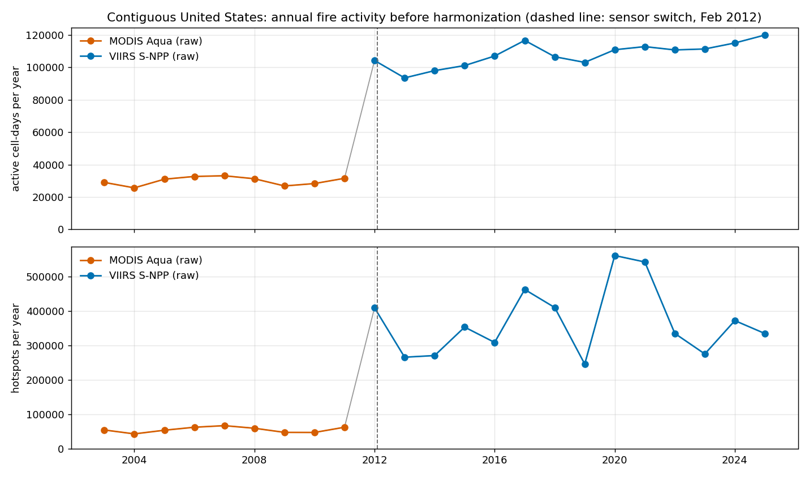
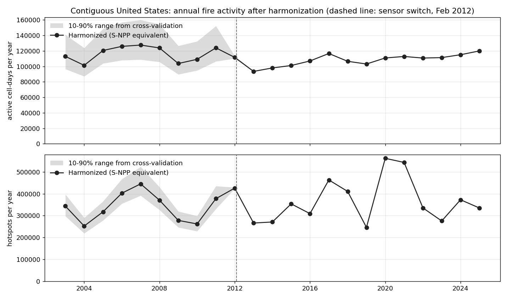
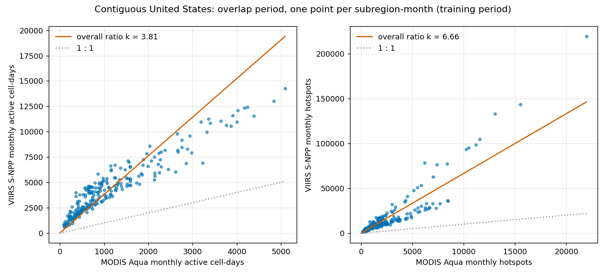
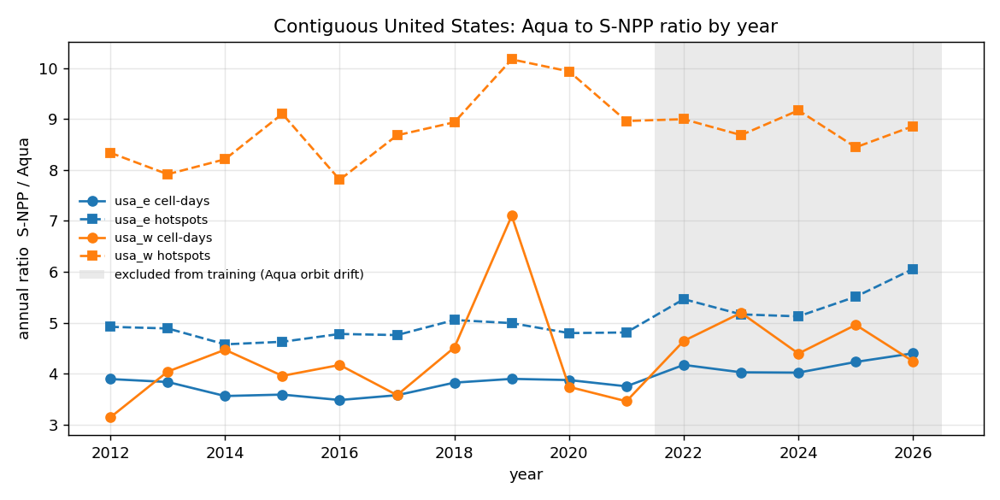

# Methods

All dates are UTC. All numbers on this page come from the data build of
2026-11-14, with data through 2026-11-13.

## 1. Why the two records cannot be compared directly

Satellites have recorded active fires since the early 2000s, but not with one
instrument.

| | MODIS (Aqua) | VIIRS (S-NPP, NOAA-20) |
|---|---|---|
| Record used here | 2003 to today | S-NPP 2012 to 2026-11-02, NOAA-20 2018 to today |
| Pixel size at nadir | about 1 km | 375 m |
| Overpass (local time) | about 13:30 and 01:30 | about 13:30 and 01:30 |

VIIRS has smaller pixels, so it detects smaller and cooler fires, and it reports
one large fire as many more pixels. The same fire activity therefore produces a
much larger number in the VIIRS record.

In our data, the contiguous United States averaged 54,985 MODIS Aqua hotspots
per year in 2003-2011 and 364,830 VIIRS S-NPP hotspots per year in 2013-2025,
6.6 times as many. A calendar built by joining the two raw records shows a jump
in 2012 that is caused by the change of instrument, not by fire.



The problem is current. S-NPP stopped producing fire data on 2026-11-02, and
MODIS is near the end of its mission. From November 2026 the record continues
with NOAA-20.

## 2. What we count

A single hotspot is one satellite pixel flagged as burning. We report two
metrics for any selected area and month.

| Metric | Definition |
|---|---|
| **Active cell-days** (default) | The area is divided into 0.1 degree cells. A cell with at least one hotspot on a UTC day counts as one. |
| **Equivalent hotspots** | The number of hotspots, converted to the VIIRS S-NPP scale. |

Active cell-days depend less on pixel size: a large fire that fills a cell
counts once for either instrument. The raw gap between the instruments is 3.6
times for cell-days and 6.6 times for hotspots in the United States.

Every value is expressed on the **VIIRS S-NPP scale**: the number S-NPP would
have reported.

## 3. Harmonization steps

**Step 1. Filter.** We keep detections that are likely vegetation fires.

| Rule | MODIS | VIIRS |
|---|---|---|
| Satellite | Aqua only | S-NPP and NOAA-20, kept separate |
| Confidence | 30 or higher | nominal or high |
| Type | 0, presumed vegetation fire | 0, presumed vegetation fire |

Terra is excluded because it passes in the morning, when fire activity differs.
Aqua and the VIIRS satellites pass at about the same time of day.

Recent near-real-time data has no type field. For those months we remove
detections that fall on known fixed heat sources. A 0.01 degree cell is a fixed
source when the standard data reported a volcano, a static land source or an
offshore source there on at least three days, and on at least half of the days
with any detection in that cell. The mask is those cells and their eight
neighbours.

We first masked every cell that had ever shown a fixed source. That removed
real fires burning next to industrial sites: 5% to 7% of vegetation fires in
the United States and Argentina and 35% in Taiwan, where fires and industry
share the same small plains. We compared eight designs, building each mask from
data through 2022 and testing it on 2023-2025. The rule above removes 1.7% of
vegetation fires in the United States, 0.1% in Myanmar, Thailand and Laos, 0.6%
in Argentina and 3.6% in Taiwan. It lets through between 4% (Taiwan) and 25%
(Myanmar, Thailand and Laos) of fixed-source detections. The two errors nearly
cancel: totals change by less than 0.5% in every region.

**Step 2. Grid.** Each hotspot is assigned to a 0.1 degree cell and a UTC day.

**Step 3. Learn the conversion in the overlap period.** When two instruments
observe the same region in the same months, the ratio of their totals is the
conversion coefficient:

```
k = sum of S-NPP values / sum of source instrument values
```

We compute one coefficient per **stratum**, a subregion and a calendar month,
and per metric. The ratio changes with fire type and season, so a single global
number would be wrong. The United States is split at 100 degrees west because
western forest fires and eastern prescribed and agricultural burns behave
differently.

| Conversion | Training period | Range of k, cell-days | Range of k, hotspots |
|---|---|---|---|
| Aqua to S-NPP | 2012-02 to 2021-12 | 2.7 to 9.2 | 4.0 to 11.1 |
| NOAA-20 to S-NPP | 2018-04 to 2025-12 | 0.82 to 1.00 | 0.85 to 1.08 |

Days on which either instrument of a pair delivered almost no data are left
out of the totals, so that both are compared over the same days (section 5).

A stratum with fewer than 200 source cell-days in the training period uses the
all-months coefficient of its subregion. This applies to all twelve months of
the Aqua conversion for Taiwan (k = 8.25 for cell-days, 9.25 for hotspots) and
to no other stratum.

**Step 4. Build one series.** Instruments switch at month boundaries and never
mix within a month.

| Period | Instrument | Value shown |
|---|---|---|
| 2003-01 to 2012-01 | MODIS Aqua | observed value x k |
| 2012-02 to 2026-10 | VIIRS S-NPP | observed value |
| 2026-11 onward | VIIRS NOAA-20 | observed value x k |

The coefficient is applied to every cell and day, so any area and any date
range sums to a harmonized value.



After harmonization the United States averages 116,615 cell-days per year in
2003-2011 against 108,250 in 2013-2025. Converted months are hatched in the
calendar so that they can always be told apart from observed months.

## 4. Validation

**Leave-one-year-out cross-validation.** For each year of the training period,
we compute the coefficients without that year, predict its S-NPP values from the
other instrument, and compare with what S-NPP observed. Each year is tested with
coefficients that never saw it.

- **Bias**: total predicted minus total observed, as a share of observed.
- **Monthly error (MAPE)**: mean absolute percentage error over months with at
  least 50 source units.
- **Rank correlation**: Spearman correlation between predicted and observed
  annual totals. It tests whether the method orders the years correctly.

Targets set before the analysis: bias within 10%, monthly error within 30%, rank
correlation at least 0.8.

### Aqua to S-NPP (2012-2021, 10 years)

| Subregion | Metric | Bias | Monthly error | Rank correlation |
|---|---|---|---|---|
| United States, west | cell-days | +1.1% | 21.2% | **0.45** |
| United States, west | hotspots | -0.2% | 15.4% | 0.98 |
| United States, east | cell-days | +0.2% | 10.0% | 0.89 |
| United States, east | hotspots | +0.1% | 8.7% | 0.95 |
| Myanmar, Thailand, Laos | cell-days | +0.2% | 11.8% | **0.79** |
| Myanmar, Thailand, Laos | hotspots | +0.3% | 13.2% | **0.62** |
| Argentina | cell-days | +0.5% | 12.4% | 0.83 |
| Argentina | hotspots | -0.3% | 8.9% | 0.89 |
| Taiwan | cell-days | +1.4% | too few fires | **0.25** |
| Taiwan | hotspots | +1.7% | too few fires | **0.27** |

### NOAA-20 to S-NPP (2018-2025, 8 years)

| Subregion | Metric | Bias | Monthly error | Rank correlation |
|---|---|---|---|---|
| United States, west | cell-days | 0.0% | 3.6% | 0.95 |
| United States, west | hotspots | +0.1% | 3.9% | 0.98 |
| United States, east | cell-days | 0.0% | 3.1% | 1.00 |
| United States, east | hotspots | 0.0% | 3.2% | 1.00 |
| Myanmar, Thailand, Laos | cell-days | 0.0% | 7.7% | 1.00 |
| Myanmar, Thailand, Laos | hotspots | 0.0% | 9.5% | 1.00 |
| Argentina | cell-days | 0.0% | 3.2% | 0.98 |
| Argentina | hotspots | -0.2% | 4.3% | 0.98 |
| Taiwan | cell-days | -0.1% | 13.7% | **0.79** |
| Taiwan | hotspots | 0.0% | 17.3% | 0.83 |

Bold values miss the target.

**What this shows.** Bias and monthly error meet the targets in every subregion
with enough fires to measure. The conversion gets the level and the season
right. For the Aqua conversion, rank correlation misses the target in three
places: for cell-days in the western United States, for both metrics in Myanmar,
Thailand and Laos, and for Taiwan. In those cases, two converted years with
similar totals may be ranked in the wrong order.

**Overlap scatter.** Each point is one subregion and month in the training
period. The line is the overall ratio.



**Aqua orbit drift.** Aqua stopped maintaining its orbit around 2022, and its
overpass has been getting later. The coefficients are applied to 2003-2011, when
the orbit was stable, so training uses 2012-2021 only. The yearly ratio for the
eastern United States is 3.5 to 3.9 in 2012-2021 and 4.0 to 4.3 in 2022-2026,
which is consistent with a drift effect. The other subregions show no clear
trend.



The same four figures exist for every region in `docs/figures/`.

## 5. Sensor outages and the NOAA-20 conversion

Two VIIRS instruments of the same design should agree, so we expected NOAA-20
coefficients close to 1. Some were as low as 0.81. We checked three explanations.

**The filters are consistent.** Over 2018-2025 the ratio of S-NPP to NOAA-20
hotspots is 1.00 in Myanmar, Thailand and Laos, 0.99 in the United States and
1.02 in Argentina. It barely changes with filtering, and it is close to 1 for
each detection type and for nominal confidence.

**S-NPP outages lowered some coefficients.** We flag a day as an outage when a
sensor's active cell count falls below 10% of its own 31-day median in at least
two of the three large regions on the same day. Fire activity in one region can
collapse because of weather; a collapse on different continents at once points
to the sensor. This finds 54 days for S-NPP, 15 for MODIS Aqua and 6 for
NOAA-20. The longest is 2022-07-27 to 2022-08-10. Outage days are now excluded
from the training totals. The July coefficient for cell-days rose from 0.89 to
0.96 in the United States and from 0.91 to 0.97 in Argentina, and the monthly
error of the NOAA-20 conversion fell from 5-7% to 3-4% in both regions. The
Aqua coefficients changed by less than 1%.

**NOAA-20 reports more isolated detections.** With outage days removed, hotspot
totals agree but NOAA-20 still has 2% to 5% more active cell-days. Cell-days
seen only by NOAA-20 outnumber those seen only by S-NPP by 5% to 14%, and they
are mostly single pixels.

**What remains unexplained.** In low-fire conditions the gap is larger: 0.92 in
Myanmar, Thailand and Laos from June to November, and 0.92 in Taiwan all year.
It is the same by day and by night, so cloud build-up between the two
overpasses does not explain it, and it is the same on sites that burn once and
on sites that burn repeatedly, so leftover fixed heat sources do not explain it
either. The coefficients absorb this difference, whatever its cause.

The outage list is derived from the hotspot record. It is not an official FIRMS
list, and it does not detect partial-day outages. The application marks a month
as incomplete when its primary sensor has three or more outage days. Values are
shown as observed and are not filled in.

## 6. Uncertainty range

Converted values are shown with a range. For each stratum we take the
cross-validation errors, expressed as (observed - predicted) / predicted, and
use their 10% and 90% quantiles:

```
lower = value x (1 + q10)        upper = value x (1 + q90)
```

Typical ranges for the Aqua conversion are -10% to +18% in the eastern United
States, -22% to +42% for cell-days in the western United States, and -65% to
+217% in Taiwan. Months observed by S-NPP have no range. When a selection spans
several strata, ranges are computed per stratum and added, which makes the range
of a long period wider than the true uncertainty.

## 7. Limitations

- **The range describes whole subregions, not small areas.** A small selection
  has more uncertainty than the range shows. The application warns when the
  historical monthly median of a selection is below 30 cell-days.
- **Taiwan has too few fires to fit a seasonal conversion.** One coefficient is
  used for all months and the range is very wide. Taiwan values before 2012
  indicate an order of magnitude, not a measurement.
- **The ratio is assumed stable in time.** Coefficients learned in 2012-2021 are
  applied to 2003-2011. If the mix of fire sizes was different then, the
  converted values are biased. This cannot be tested, because VIIRS did not
  exist.
- **Year ranking is unreliable in three subregions** for the period before
  2012, as shown in section 4.
- **NOAA-20 coefficients are below 0.9 in some low-fire months** (minimum 0.87
  in Myanmar, Thailand and Laos, 0.82 in Taiwan). Part of the difference from
  S-NPP is unexplained (section 5).
- **Outage days lower the observed values.** Months with outages are marked but
  not corrected. S-NPP has 16 outage days in 2026, its last year.
- **Recent months are provisional.** Near-real-time data is used from
  2026-08-01 for VIIRS. It has no type field, so fixed heat sources are removed
  with a mask (section 3, step 1). In a test on 2023-2025 the mask removed 0.1%
  to 3.6% of real vegetation fires and let through 4% to 25% of fixed-source
  detections, with a net effect on totals below 0.5%. FIRMS later replaces
  near-real-time data with standard data.
- **Only afternoon and night overpasses are used.** Morning fire activity seen
  by Terra is not represented.
- **Days are UTC days**, not local days.
- **Hotspots are not burned area.** A count of detections says where and when
  fire was seen, not how much land burned.
- **Coverage is limited to four regions**: the contiguous United States,
  Taiwan, Myanmar with Thailand and Laos, and Argentina.

## 8. Data

| Region | Active cell-days | Hotspots available for download |
|---|---|---|
| Contiguous United States | 1,888,331 | 6,023,532 |
| Myanmar, Thailand, Laos | 3,399,578 | 9,496,343 |
| Argentina | 1,075,233 | 3,104,974 |
| Taiwan | 8,336 | 10,820 |

**Source.** NASA Fire Information for Resource Management System (FIRMS),
https://firms.modaps.eosdis.nasa.gov/ : MODIS Collection 6.1 active fire
product, VIIRS S-NPP 375 m active fire product, VIIRS NOAA-20 375 m active fire
product. Standard-processing data from FIRMS country files for 2002-2025.
Data for 2026 from the FIRMS area API, standard processing through 2026-07-31
for VIIRS and 2026-08-31 for MODIS, near-real-time after that.

**Country boundaries.** Natural Earth 1:10m Admin 0 Countries, public domain,
https://www.naturalearthdata.com/ . Used to clip 2026 API results to the same
countries as the FIRMS country files. Checked on 2025 data: identical for
Taiwan, Argentina and the United States; 28 of 40,586 detections missing on the
border for Myanmar, Thailand and Laos.

**Reproducibility.** `pipeline/build_all.sh` rebuilds every data file from the
FIRMS source files. The code is in the `pipeline/` directory of the repository.

**Use of SI.** The data pipeline code and the first draft of this page were
written with the assistance of Claude (Anthropic), following the team's
specification. All figures are plotted from data.
